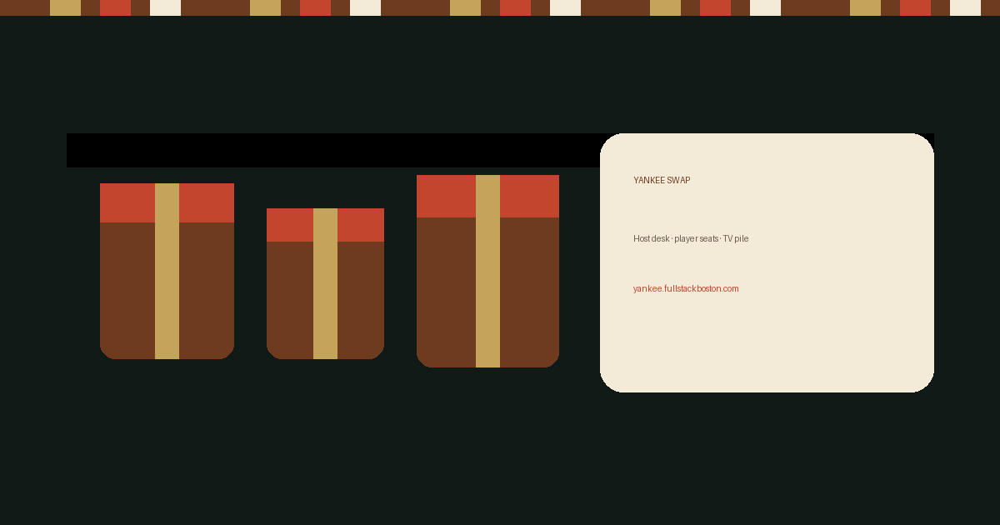

# Yankee Swap

[](https://github.com/jonaldoalix/yankeeswap/actions/workflows/ci.yml)
[](./LICENSE)

Host a digital Yankee Swap from a phone, a TV, and every player's seat.

**Museum demo:** [yankee.fullstackboston.com](https://yankee.fullstackboston.com)



This is the sibling showpiece to [Secret Santa Pairer](https://santa.fullstackboston.com). Same craftsmanship, different identity: parcel kraft, brass, and cherry — not a candy-cane reskin.

## Features

- Three seats on one server session: **host desk**, **player phone**, **spectator / TV**
- Signup with name and a gift contribution that stays secret until unwrap
- Shuffled turn order — players do not pick their place in line
- Take from the pile or steal from the phone; host may veto, otherwise auto-allow in 8 seconds
- Thirteen optional mods (freeze, no revenge, first-last, turn clock, chain cap, gentle, fate, duel, shield, spare, mercy, coin, rotate)
- Host clerk toggle: default fogged so a playing host does not see internals
- Shared timer and live updates (SSE) so the kitchen sees the same pile as the living room
- Installable PWA with offline shell caching (API always network-only)
- Museum mode: seeded demo party, banner, noindex

## Quick start

```bash
cp example.env .env
npm install
npm run dev
```

- API: `http://127.0.0.1:1224`
- UI (Vite): `http://127.0.0.1:5173` (proxies `/api`)

Production:

```bash
npm run build
npm start
```

Docker (museum-style demo on port 1224):

```bash
cp example.env .env
docker compose up -d --build
```

## How a party runs

1. Host opens **Run the night** (optional `HOST_PIN`).
2. Put **Watch the pile** on the TV. The join code is on the board.
3. Players join from their phones and type what they brought — the TV never sees it until unwrap.
4. Shuffle order, start the swap. First player takes from the pile; later turns may steal. Veto only if you must.
5. Picture time, then reset for next year.

Mods live on the host clerk. Wrapped gifts stay Wrapped even when clerk is open.

## Security model

The API is meant for a **trusted host** (you, on a LAN). Join code + optional host PIN are not internet-grade auth. See [SECURITY.md](./SECURITY.md).

`MUSEUM_MODE=true` seeds a demo roster and advertises itself as a sandbox.

## Scripts

| Script | Purpose |
|--------|---------|
| `npm run dev` | API + Vite client |
| `npm test` | Unit + API tests |
| `npm run test:coverage` | Same tests with **100%** line/branch gate on `shared/` + `server/src/` |
| `npm run lint` | oxlint + TypeScript |
| `npm run build` | Client + server build |
| `npm start` | Serve built app |

CI on `main` also runs OSV (lockfile) and Semgrep (JS/TS/React).

## Contributing

See [CONTRIBUTING.md](./CONTRIBUTING.md). Please report vulnerabilities privately per [SECURITY.md](./SECURITY.md).

## Why

Built so a family Yankee Swap could keep score on a phone and a TV without the host memorizing every steal — and without leaking wrapped gifts to the room.
